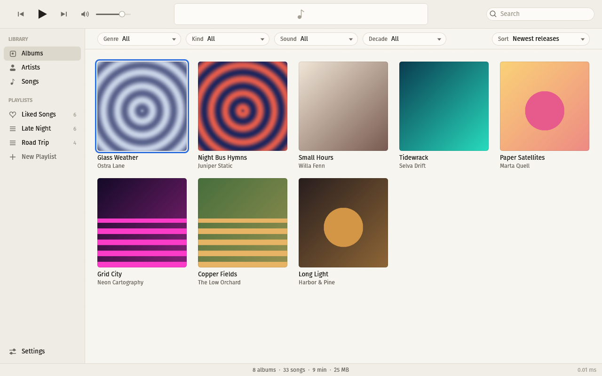
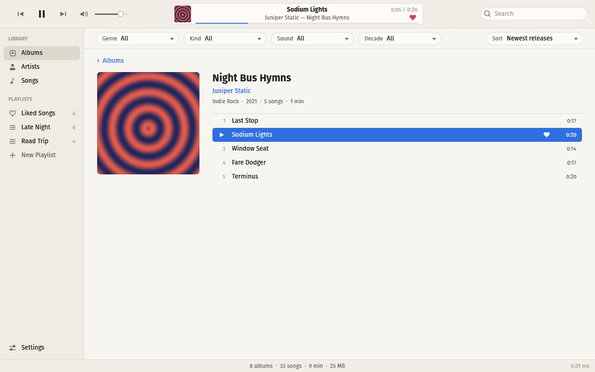
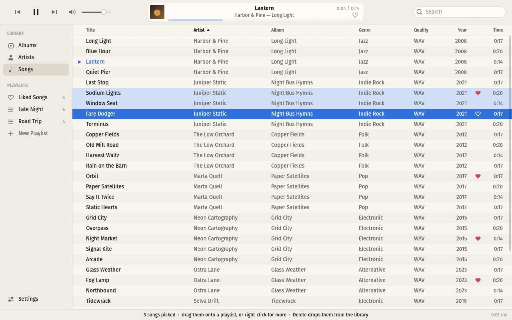
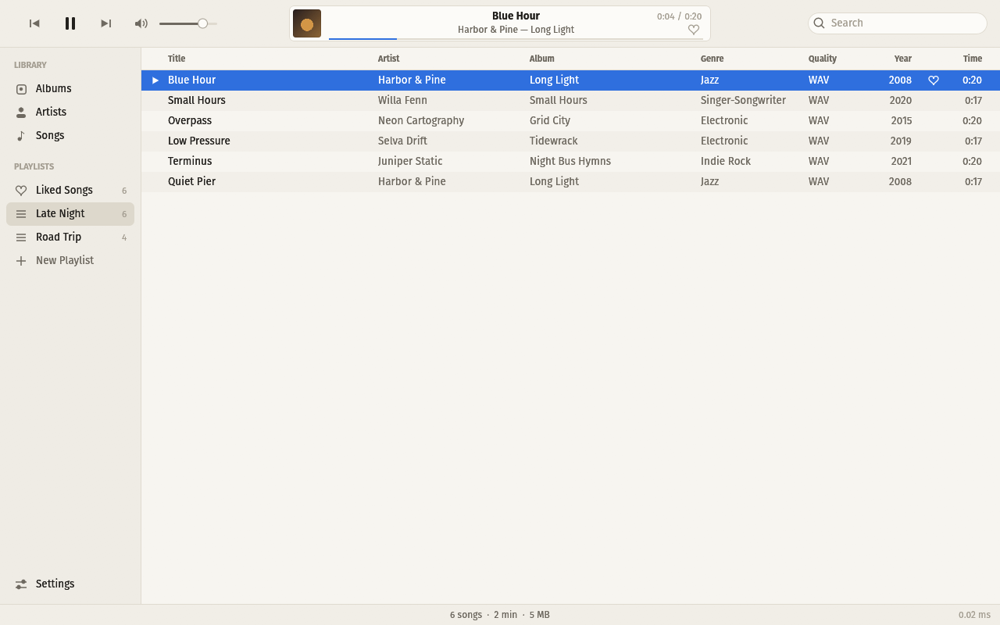
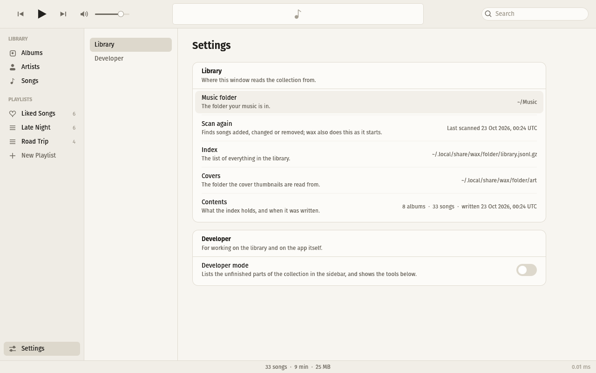
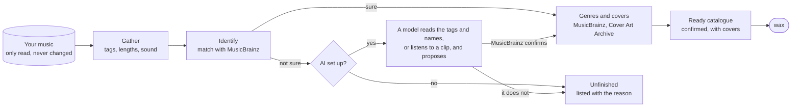

# wax

A keyboard-first music player for the music you own. Point it at a folder,
and it lists your albums, artists and songs, finds anything as you type, and
plays it. No account, no streaming, no network: your music stays where it is,
and wax never changes, moves or deletes a file of it.



The music in these screenshots is made up: invented bands, generated tones
and drawn covers, from [`tools/make_demo_library.py`](tools/make_demo_library.py).

## What it does

- **Albums, Artists, Songs**, like the music players you know. Every album
  with its cover; an artist's albums beside the list of artists; every song in
  one sortable table.
- **Search as you type.** Every key press is answered in well under a
  millisecond, even with tens of thousands of songs.
- **Filters and sorting.** By genre, sound quality and decade, and by kind
  (album, EP, single) where the importer has named it; albums by release
  date, date added, artist, title or best sound.
- **Liked songs and playlists.** Like a song with its heart or Shift-L. Pick
  several songs (click, Shift-click, Ctrl-click, Shift-arrows), then drag them
  onto a playlist in the sidebar, or onto "New Playlist" to make one.
- **Shuffle that is random.** Shuffle songs, whole albums, or an artist at a
  time, from whatever is on screen: the library as filtered, an album, a
  playlist. Nothing is favoured for being new or often played, and each list
  plays every song once before any comes round again, even across restarts.
- **Keyboard first.** Everything has a key, and `?` lists them. The mouse
  works too.
- **Stays up to date.** wax looks through your music folder each time it
  starts, and picks up songs added, changed or removed.
- **Plays** MP3, AAC and ALAC (M4A), FLAC, Ogg Vorbis and WAV.

| An album | Picking songs |
| --- | --- |
|  |  |
| **A playlist** | **Settings** |
|  |  |

## Get started

wax is written in Rust and is developed on Linux (Wayland and X11). macOS and
Windows may work but are untested; help there is welcome.

```sh
# Debian and Ubuntu; other systems have the same ALSA package by another name
sudo apt install build-essential pkg-config libasound2-dev

# Rust, if you do not have it: https://rustup.rs
cargo build --release
./target/release/wax
```

The first time it starts, wax asks where your music is. Type the folder
(`~/Music`, say) and press Enter: it reads the tags and covers of every song
there, which takes a minute for a large collection, and from then on only
looks for what changed.

No music at hand, or would rather not try it on yours first? Make the
made-up library from the screenshots and choose that folder:

```sh
python3 tools/make_demo_library.py ~/wax-demo
```

wax draws its text in Inter, Fira Sans or Noto Sans, whichever is installed,
and falls back to a built-in font.

## Keys

| Key | |
| --- | --- |
| `1` `2` `3` | Albums, Artists, Songs |
| arrows, or `h` `j` `k` `l` | move |
| `Enter` | open the album, play the song |
| `Esc` | close the album, then clear the search |
| `/` | search as you type; Enter acts on the top hit |
| `Tab` | switch between the sidebar and the content |
| `g` `G` | top, bottom |
| `Ctrl-d` `Ctrl-u` | half a page down, up |
| `s` `S` | albums: next, previous order; songs: next column, reverse |
| `f` | filter by genre, kind, sound and decade; sort the albums |
| `Space` | pause |
| `Shift-↑` `Shift-↓` `Ctrl-a` | pick several songs, pick all |
| `Shift-L` | like or unlike the song, or the one playing |
| `p` | add to a playlist, and more |
| `Ctrl-n` | new playlist |
| `F2` | rename the playlist (in the sidebar) |
| `Delete` | hide the picked songs from the library; in a playlist, take them out |
| `n` `N` | next track, previous track |
| `x` `X` | shuffle songs, albums, artists, or not; or the button left of the others |
| `[` `]` | back, forward ten seconds |
| `-` `=` | volume down, up; or the slider beside the buttons |
| `m` | sound off, on |
| `Ctrl-,` | settings |
| `?` | show or hide the list of keys |
| `Ctrl-q` | quit |

## Where wax keeps things

| What | Where |
| --- | --- |
| Settings | `~/.config/wax/settings.json` |
| The list of your music, and cover thumbnails | `~/.local/share/wax/folder/` |
| Liked songs and playlists | `~/.local/state/wax/playlists.json` |
| Songs hidden with Delete | `~/.local/state/wax/discarded.txt` |
| What has played, and where each shuffle stands | `~/.local/state/wax/played.jsonl`, `shuffle.json` |
| Songs fetched from a server ([importer](importer/README.md#on-a-server)) | `~/.cache/wax/audio/`, at most 4 GB |

Nothing else is written, and nothing is sent anywhere. Deleting a song in wax
hides it; the file stays where it is.

## The importer: for a messy collection

Years of rips, downloads and copies leave a collection with missing tags,
misspelt artists, albums split over folders, duplicates and no covers. wax
plays such a collection as it is. The importer, in [`importer/`](importer/),
is a separate, optional tool that sorts it out without touching a file: it
identifies every song against [MusicBrainz](https://musicbrainz.org), finds
genres and covers, and writes a clean catalogue for wax to show, in which
every album is confirmed, complete or marked with what it lacks, and has its
cover. Everything it could not confirm is listed apart, with the reason.

It works without any AI. AI models, if you set them up, help with what
MusicBrainz cannot settle on its own, and nothing a model says counts until
MusicBrainz confirms it.



How to set it up, what it asks of which service, and what AI costs:
[importer/README.md](importer/README.md).

## Project layout

| Folder | |
| --- | --- |
| `crates/app` | the player |
| `crates/core` | the library model: the index format, search, sorting and filters |
| `crates/scan` | reading a music folder into an index; also the `wax-scan` command |
| `importer/` | the importer, in Python |
| `tools/` | the made-up demo library |
| `docs/` | screenshots |

## Contributing

Contributions are welcome: see [CONTRIBUTING.md](CONTRIBUTING.md).

## License

wax is free software under the [GNU General Public License, version 3 or
later](LICENSE). You may use, study, share and change it; if you share a
changed version, share its source under the same license.
