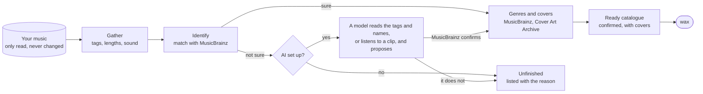

# The wax importer

The importer is for a messy collection: years of rips, downloads and copies,
with missing tags, misspelt artists, albums split over folders, duplicates
and no covers. It works out what every song really is, and writes a clean
catalogue for [wax](../README.md) to show:

- every album **matched** with a release in [MusicBrainz](https://musicbrainz.org),
  by its songs' names and lengths, not by its folder name alone;
- **complete**, or listed with the songs it lacks, shown greyed out in wax;
- with a **genre** and a good **cover**;
- one name per artist, one copy per album (the best sounding one), and one
  entry for a single held in several formats.

Albums it confirms song by song get a small *verified* badge in wax.
Everything it could not confirm is listed apart, with the reason, so you can
see what is left to do.

**It never changes your music.** It only reads the files; what it finds goes
into its own catalogue. Your music folder can be mounted read-only.

## How it works



It runs in steps, each of which can be run alone and stopped and started
again; the `nightly` run does them all in order.

| Step | What it does |
| --- | --- |
| `gather` | reads every file's tags, length and sound (and a fingerprint, if `fpcalc` is installed) |
| `hear` | *optional:* asks [AcoustID](https://acoustid.org) which recording each fingerprint is |
| `identify` | matches each folder, or each loose song, with a MusicBrainz release, from its tags, names, lengths and fingerprints; a song is *certain* only when its length or its sound agrees too |
| `judge` | *AI, optional:* a model is shown what MusicBrainz could not settle and proposes what it is |
| `listen` | *AI, optional:* a model that can hear is played a clip of what is still unknown |
| `genre` | gives every album a genre from MusicBrainz; *with AI,* a model files it under Apple's genre list |
| `artwork` | finds each release's front cover: Cover Art Archive, then the covers in your own folders, then (if allowed) Deezer |
| `ready` | writes the ready catalogue for wax, and the unfinished list beside it |
| `report` | writes up where the collection stands, with lists of what is missing, unknown or damaged |

### With and without AI

| | Without AI | With AI |
| --- | --- | --- |
| Matching | tags, file and folder names, lengths, MusicBrainz ids in tags, fingerprints | the same, and then a model looks at what is left: it knows discographies, track lists and how rippers name files, and can listen to a clip |
| What counts | only what MusicBrainz confirms by names and lengths | the same: a model's answer is put to MusicBrainz like any other claim, and what it does not confirm is kept as a proposal, not a fact |
| Genres | from the genres MusicBrainz users voted on, sorted onto a short list of shelves | a model files each album under one genre (and a subgenre) of Apple's list |
| Cost | free | a cheap model through [OpenRouter](https://openrouter.ai), held to a budget per run, or the [Claude Code](https://claude.com/claude-code) you already have |

Without AI more of a messy collection ends up unfinished, each song with the
reason; nothing wrong gets in either way.

## Setting it up

You need Python 3.11 or later, [mutagen](https://mutagen.readthedocs.io) and
[ffmpeg](https://ffmpeg.org):

```sh
sudo apt install python3 python3-mutagen ffmpeg      # Debian, Ubuntu
```

Optional: `fpcalc` from [Chromaprint](https://acoustid.org/chromaprint) for
fingerprints, and `sshfs` to read music on another machine.

The importer keeps everything it makes in one folder, `~/wax` (or wherever
`WAX_HOME` says): its catalogue, a cache of what MusicBrainz said, the covers,
and the ready catalogue. Its settings are in `librarian.toml` there; copy
[`librarian.example.toml`](librarian.example.toml) and set at least where
your music is:

```sh
mkdir -p ~/wax
cp importer/librarian.example.toml ~/wax/librarian.toml
$EDITOR ~/wax/librarian.toml
```

Then run it from this folder:

```sh
cd importer
python3 -m librarian nightly          # every step, in order
python3 -m librarian identify --help  # or one step at a time
```

The first run of a large collection takes hours: MusicBrainz is asked one
question a second, as it asks of everyone, and every answer is kept, so the
next runs ask only about what is new. Once it is done, run it now and then,
or every night from cron, to take in new music.

### Keys

Keys for outside services go in `~/wax/secrets.env`, which only you may read
(`chmod 600`); the importer refuses one that others can:

```sh
OPENROUTER_API_KEY=...   # for "openrouter:" models
ACOUSTID_KEY=...         # for the hear step: free from https://acoustid.org/new-application
```

### AI

AI is off until you name models in `librarian.toml`:

```toml
judges = ["openrouter:google/gemini-3-flash-preview"]   # tried in order: a cheap one first
listener = "openrouter:google/gemini-3-flash-preview"   # must accept sound
budget_usd = 1.0                                       # the most one step may spend in one run
```

A model named `claude:sonnet` asks the [Claude Code](https://claude.com/claude-code)
installed on the machine, on its owner's subscription; `claude_questions`
caps how many questions one run may ask of it. Models are given no tools and
no access to anything: they are handed text, or a sound clip, and answer.

## Playing the catalogue in wax

The ready catalogue is `~/wax/ready/library.jsonl.gz`, with the covers beside
it. On the machine the importer ran on, open it in wax; it plays the songs
from your music folder:

```sh
wax --index ~/wax/ready/library.jsonl.gz
```

In wax, Settings → Developer mode shows the unfinished part too, in the
sidebar, sorted by what each song still wants.

### On a server

The importer can run on a server that holds the music, or mounts it (set
`remote` in `librarian.toml` to read folders from another machine over
SSH), while wax runs on your desktop:

1. Copy the catalogue to your desktop, where wax looks for it when no music
   folder is chosen in its settings:
   `rsync -a server:wax/ready/ ~/.local/share/wax/`
2. Tell wax the server, as `ssh` knows it, and the importer's folder there,
   in `~/.config/wax/settings.json`: `"server": "server", "home": "wax"`.
   The importer's `librarian` folder must be in that folder on the server.

wax then fetches each song over SSH as it is played (and the next one ahead
of time), into a cache of at most 4 GB. Nothing listens on the server for
this: wax runs `python3 -m librarian file` there over your own SSH login, and
that hands over only files inside the music folders. Songs you hide in wax
are sent back the same way, and left out of the catalogue from then on.

## What is sent where

| Service | When | What it is told |
| --- | --- | --- |
| [MusicBrainz](https://musicbrainz.org) | always | the artist, album and song names, lengths and MusicBrainz ids your files carry, to look them up |
| [Cover Art Archive](https://coverartarchive.org) | always | the MusicBrainz ids of releases, to fetch their covers |
| Apple | with AI on | nothing about your music: Apple's list of genres is downloaded, now and then |
| [Deezer](https://www.deezer.com) | `deezer = true` | the artist and title of a record no other source has a cover for |
| [AcoustID](https://acoustid.org) | the `hear` step, with its key | fingerprints of the sound |
| [OpenRouter](https://openrouter.ai) | `openrouter:` models | for what MusicBrainz could not settle: the tags, file and folder names, and (for the listener) a clip of under a minute |
| Claude Code | `claude:` models | the same as OpenRouter, but no clips |

MusicBrainz asks every program to say who runs it: set `contact` in
`librarian.toml` to your email address or web page, or the project's page is
given.

## Commands

```text
python3 -m librarian nightly     every step listed in librarian.toml, in order
python3 -m librarian gather      examine new and changed files
python3 -m librarian hear        look fingerprints up at AcoustID
python3 -m librarian identify    match files to releases in MusicBrainz
python3 -m librarian judge       have a model look at what is unsettled
python3 -m librarian listen      play a clip of what is still unknown to a model
python3 -m librarian genre       give every album held with certainty its genre
python3 -m librarian artwork     fetch the front cover of every release held with certainty
python3 -m librarian ready       write the catalogue of finished releases for the player
python3 -m librarian report      write up where the collection stands
python3 -m librarian file PATH   write one file of the library to standard output, for the player
python3 -m librarian discard     note the files, named on standard input, that were dropped in the player
```

Each step takes `--help`.
